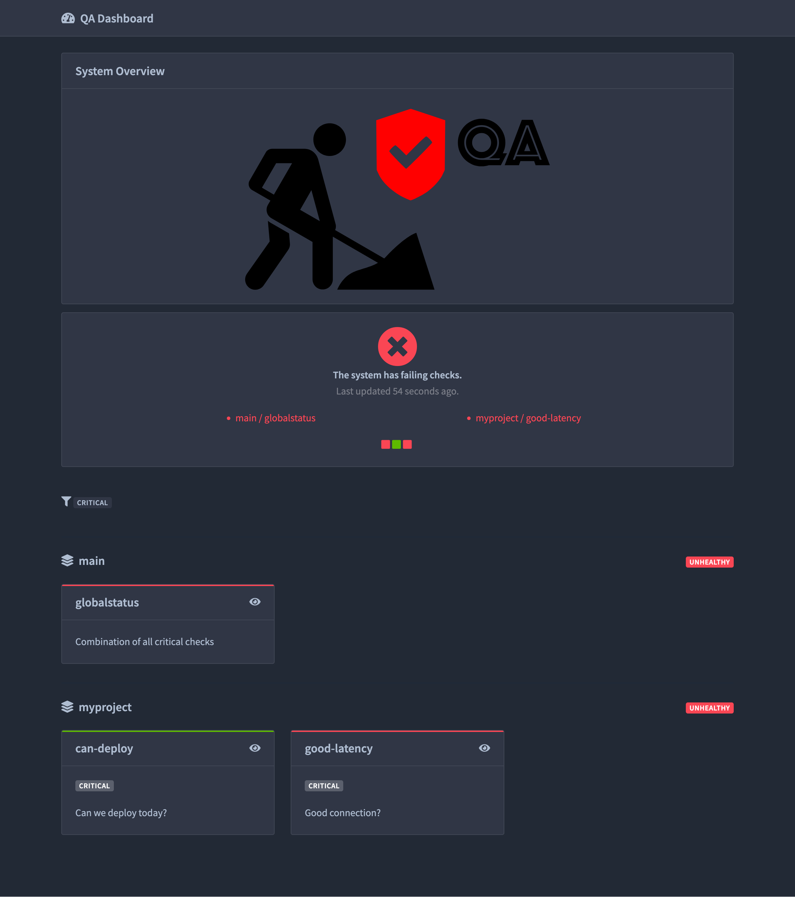

# Telescope Example

A minimal [Telescope](https://github.com/mozilla-services/telescope) setup with a custom check.

## Contents

- `config.toml`: checks definitions
- `mychecks/`: custom checks modules (added to the `PYTHONPATH`)
- `diagram.svg`: diagram shown on the dashboard
- `docker-compose.yaml`: runs the `mozilla/telescope` container

## Run

```
docker compose up
```

Then open http://localhost:9797

## Run checks from the command line

```
docker compose run --rm telescope check
docker compose run --rm telescope check myproject can-deploy
```

## Add a check

1. Create a module in `mychecks/` with an `async def run(...)` function that returns a `(success, details)` tuple
2. Declare it in `config.toml`:

```toml
[checks.myproject.my-check]
description = "What it checks"
module = "mymodule"
params.some_param = "value"
```

3. Restart with `docker compose restart`


## Screenshot


